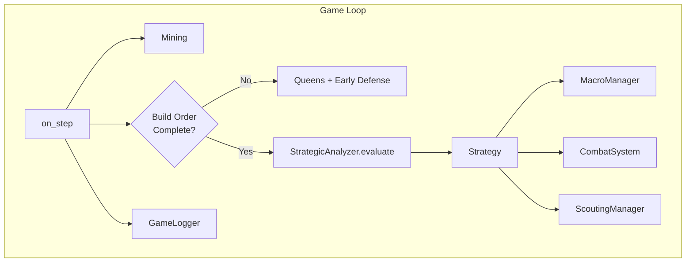
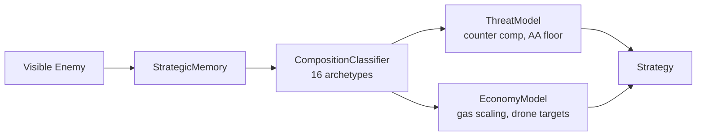
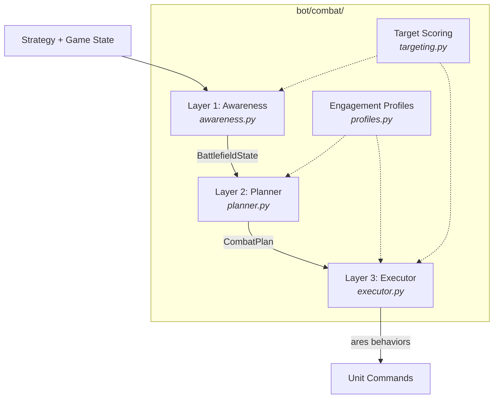
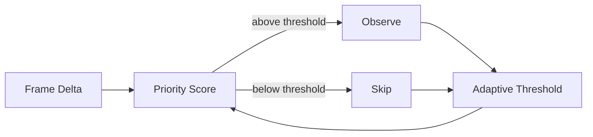

# SC2 Information-Gain Bot

A StarCraft II Zerg bot that treats **attention as a finite resource**. It selectively observes game state using Bayesian surprise, skipping ~50% of frames with zero critical misses, while a three-layer combat system translates strategic intelligence into archetype-specific micro.

**269 tests** | Beats Medium AI | Full JSONL game logging

---

## Status

| Phase | Description | Status |
|-------|------------|--------|
| 1 | Playable bot (macro, queens, build order) | Complete |
| 2 | Instrumentation (JSONL logging, delta tracking) | Complete |
| 3 | Info-gain scheduler (Bayesian observation skipping) | Complete |
| 4 | Three-layer combat (perception → planning → micro) | Complete |
| 5 | Learned scheduler (replace heuristics with ML) | Planned |
| 6 | Evaluation / Ladder (SC2 AI Arena) | Planned |

---

## Architecture



### Strategy Pipeline



The `StrategicAnalyzer` reads game state every 2 seconds and outputs a `Strategy` dataclass containing threat assessment, economy plan, army composition, tech targets, and attack readiness.

### Three-Layer Combat System



| Layer | Module | Input | Output |
|-------|--------|-------|--------|
| **Perception** | `awareness.py` | Game state, strategy | `BattlefieldState` (enemy estimate, targets, staging point, confidence) |
| **Decisions** | `planner.py` | Battlefield + strategy | `CombatPlan` (objective, approach, squads, profile) |
| **Execution** | `executor.py` | Combat plan | ares-sc2 behaviors (kiting, focus fire, AOE, pathing) |

**Engagement profiles** (`profiles.py`) map each of 16 enemy archetypes to micro rules: focus targets, kite style, spread distance, and ability priorities. Example: vs BIO, prioritize Medivacs, spread 3.0, bile clumps; vs SKYTOSS, kite forward, prioritize Carriers.

**Target scoring** (`targeting.py`) operates at two levels:
- *Strategic*: Where to attack (base value, distance, enemy army proximity, info staleness)
- *Tactical*: What to kill (profile focus bonus, wounded bonus, support bonus, range/distance)

### Info-Gain Scheduler



Per-frame priority = surprise + phase weight + combat bonus + enemy bonus - production discount. Budget 0.4 achieves ~50% skip rate with 0 critical misses.

---

## Quick Start

**Prerequisites:** StarCraft II (free Starter Edition), Python 3.11-3.12, Poetry

```bash
git clone --recurse-submodules <repo-url>
cd SC2-BOT
poetry install --with test

# Play a game
poetry run python run.py

# Run tests (no SC2 needed)
poetry run pytest

# Validate game logs
poetry run python scripts/validate_logs.py
```

---

## Project Structure

```
bot/
  main.py                MyBot(AresBot) -- lifecycle, role assignment
  macro.py               MacroManager -- drones, tech, army production
  queens.py              QueenManager -- inject, creep, transfuse
  scouting.py            ScoutingManager -- overlord positioning
  combat/
    __init__.py           CombatSystem orchestrator (public entry point)
    constants.py          Enums, dataclasses, unit type sets
    profiles.py           17 engagement profiles per enemy archetype
    targeting.py          Strategic + focus fire target scoring
    awareness.py          Layer 1: enemy tracking, staging, terrain
    planner.py            Layer 2: objective, approach, squad assignment
    executor.py           Layer 3: profile-driven per-unit micro
  strategy/
    analyzer.py           StrategicAnalyzer -- orchestrates pipeline
    composition.py        CompositionClassifier -- 16 archetypes
    threat_model.py       ThreatModel -- counter comp, AA floor
    economy_model.py      EconomyModel -- drone/gas/base targets
    memory.py             StrategicMemory -- persistent scouting data
    unit_counter_db.py    Unit profiles, counter maps, tech reqs
  logging/
    game_logger.py        Buffered JSONL writer
    snapshot.py           State extraction
    delta.py              Frame diffs, surprise scoring
    schemas.py            TypedDict definitions for all record types
  info_gain/
    scheduler.py          ObservationScheduler -- skip/observe

tests/                   269 tests (no SC2 needed)
config.yml               Bot + logging + info-gain configuration
zerg_builds.yml          Build order (ares-sc2 format)
ares-sc2/                Framework (git submodule)
```

---

## Logging

Every game writes `data/logs/YYYYMMDD_HHMMSS_MapName.jsonl`:

| Record | Frequency | Content |
|--------|-----------|---------|
| `state` | ~2.2/sec | Economy, units, positions, delta, surprise score |
| `skip` | Per skipped frame | Priority, threshold, reason (info-gain scheduler) |
| `decision` | Per action | Module, action, reasoning context |
| `event` | Per lifecycle | Unit/building created, destroyed, completed |
| `summary` | Once | Result, cumulative stats, surprise statistics |

---

## Research

> *Can a bot skip 50%+ of game state observations without meaningful decision quality loss?*

**Result:** Yes. The analytical scheduler (Phase 3) skips 50.7% of frames with zero critical misses. The bot won its validation game with the scheduler active. Phase 4 will replace heuristics with a learned model.
